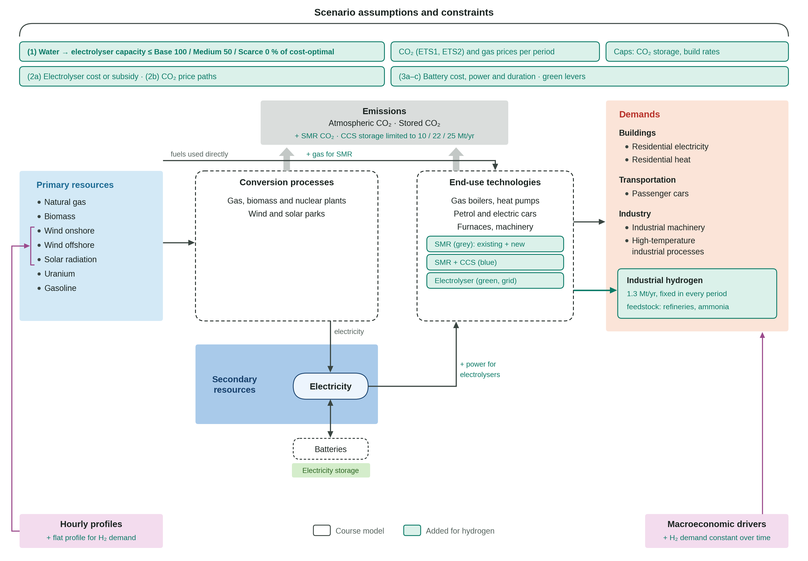

# Model notes: final course model + hydrogen extension

*This note covers the model in the set-up agreed with Francesco on 14 October and the group decisions of 15 October: the base is 100% (no water scarcity). Since 16 October the study comes in **two packages that run the same analysis**: without the additions, and with them (hydrogen storage, the pure green route and pink hydrogen) in every run (section 5.11). It says what changed and how the model works now. It also checks the model against the final course model and the numbers against their sources, gives the results, and suggests text for the report and the presentation. Unless a section says otherwise, the numbers are those of the package without additions (30 runs); the package with additions has 45 runs. Each package also writes its own numbers to `docs/results_summary.md`. HiGHS, 15-hour steps.*

## In short

**What changed on 15 October (group)**

**The base is the scenario without water scarcity (100%).** The scenario numbers follow:

| Scenario | Water | Electrolyser capacity |
|---|---|---|
| **S1 Base** | no scarcity | no limit (the cost-optimal reference) |
| **S2 Medium** | medium scarcity | at most 50% of Base |
| **S3 Scarce** | high scarcity | none |

S1 and S2 have swapped compared with the report of 5 October. `docs/report_tables_check.md` lists every place in Tables 1–3 that changes.

**Three additions** (since 16 October: a second package has them in every run; the package without additions does not have them):
- **Hydrogen storage** in salt caverns, up to 0.22 / 0.9 / 5 TWh in 2030 / 2040 / 2050.
- **The pure green route:** the electrolyser's own offshore wind and solar, with no grid connection.
- **Pink hydrogen:** the electrolyser's own nuclear plant. "Pink" is the colour for nuclear electrolysis in the Broadleaf scheme that van der Zwaan showed in the guest lecture of 7 October.

The water limit applies to every electrolyser, whatever its power source.

**Figures, in colour, in two versions.** `energy_model/presentation.py` draws every result figure twice: for the slides (sized for the group's template) and in APA style for the report (6.5 inches wide, text 8 pt or more, no titles or notes in the image; `results/figures/apa`). Figures 1–3 of the report are in colour too, with a black-and-white version (`--bw`) and slide versions (section 7). The implementation and difficulties slides are drafted in the deck.

**Green levers (16 October).** Three ways to get more green hydrogen inside the water scenarios: electrolysers on desalinated seawater (outside the water limit), a production subsidy of €1–2 per kg, and a 60% mandate (section 5.9).

**What the model shows**
- **Up to 2040 the scenarios are the same.** In 2030 the existing reformers make all the hydrogen (grey). In 2040 blue hydrogen takes over.
- **In 2050 water decides how much of the hydrogen is green:**
  - Base builds 7.1 GW of electrolysers and makes 54% of its hydrogen by electrolysis.
  - Medium may build half and makes 25%.
  - Scarce makes none.
- **Water scarcity costs money, gas and CO₂.** Compared with Base, over 2020–2059:

  | | System cost | Gas imports | CO₂ |
  |---|---|---|---|
  | Medium | +€2.4 bn | +218 TWh | +49 Mt |
  | Scarce | +€5.1 bn | +453 TWh | +94 Mt |

  That is about €1 per kg of green hydrogen that cannot be made.
- **Blue hydrogen competes with industry for the capped CO₂ storage.** Less electrolysis therefore raises CO₂ mostly in industry.
- **Limiting electrolysis does not save water.** Blue hydrogen uses more water per kg than electrolysis, mostly cooling water. Water for hydrogen goes from 32 Mm³/yr in Base to 36 Mm³/yr in Scarce.
- **Of the additions, only hydrogen storage matters, and only in Base.** It raises electrolysis to 84% of the hydrogen and saves €1.3 bn. Under a water limit it is not used. Pure green and pink hydrogen are never chosen, and requiring pure green costs €5.1 bn.
- **Cheaper electrolysers add no green hydrogen; the CO₂ price does.** In Base the share made by electrolysis is 31% / 54% / 73% at the low / central / high CO₂ price. At the high price, water scarcity costs €11–23 bn instead of €2–5 bn.
- **Of the green levers, only water from outside the fresh-water chain lifts the limit.**
  - With desalinated seawater (€0.03/kg), Medium and Scarce get the electrolysers of Base back: −€2.3 bn and −47 Mt CO₂ (Medium), −€5.0 bn and −93 Mt (Scarce). It still pays at ten times the water cost.
  - A production subsidy of €1–2/kg makes the same electrolysers run more hours (Medium: 25% → 41–48% electrolysis) but hardly lowers CO₂.
  - A 60% mandate is infeasible under a water limit unless desalinated water is allowed.
- **The package with additions tells the same policy story** (section 5.11). Medium and Scarce do not change. Base builds more electrolysers with storage, so water scarcity costs more: +€3.7 / +€6.4 bn and +110 / +155 Mt CO₂.
- Details are in section 5.

**Decisions for the group** (each is one setting)
1. **The report text and tables** still use the old numbering (S1 = 50%). See `report_tables_check.md`.
2. **What the 1.3 Mt is used for:** feedstock (now; it comes on top of the course demands) or fuel for heat (section 5.8).
3. **Scarce at 0% or 10%** (section 5.5).
4. **Which package to present: without or with the additions.** Both packages and both decks are ready (section 5.11).
5. **The water limit with the additions.** It is the same in MW as without them, for all electrolysers together (section 1.1). The alternative, 50% of Base *with the additions*, gives Medium more water whenever the additions make Base build more electrolysers.
6. **Whether the green levers go in the report or only in the back-up slides** (section 5.9; suggested text in 6.5).

## 1. The set-up

| What was decided | What the model does | Where |
|---|---|---|
| "What you need is just a demand for hydrogen" (14 Oct) | Demand `industrial_h2` on the bus `Hydrogen`: 43.3 TWh/yr (1.3 Mt × 33.33 MWh/t), exponent 0 (constant over time) | `demand.xlsx` |
| "Industrial demand is very flat … just go for that" | Flat hourly profile | `demand.xlsx` |
| "That demand will stay the same … the only thing that varies is water" | The same demand in all periods and scenarios; a growing path is available as a variation (`h2_demand_mt='high'`) | `hydrogen.py` |
| "Three new technologies in the technology table … they are all links" | **SMR:** bus0 `Gas supply`, bus1 `Hydrogen`, bus2 `CO2 atmosphere`. **SMR CCS:** the same plus bus3 `CO2 storage` (90% captured). **Electrolyser:** bus0 `Electricity`, bus1 `Hydrogen`. Sector "Industry": they feed the demand directly | `technologies.xlsx` |
| "Exogenously limit this capacity to mimic … less water", in the capacity constraints | A `max` row for each electrolyser in the capacity constraints, written per scenario | `hydrogen.apply_scenario_inputs` |
| "100% is going to be the base" (15 Oct) | S1 Base: no limit, the reference run; S2 Medium: 50% of S1; S3 Scarce: 0% | `SCENARIOS` |
| "Put the storage in as an option, and the same for the pure green route; add nuclear" (15 Oct) | `h2_storage`, `pure_green`, `pink`: in every run of the package with additions; not in the package without | `energy_model/package.py`, `make_scenario()` |
| "Within these three scenarios you can have variations … by changing the relative costs"; a subsidy as "a twenty percent decrease" | (2a) subsidy 20% and 40%, low cost path; (2b) CO₂ price low and high; (2c) storage at 3× the cost; (3a–c) batteries | `run_batch.py` |
| "The cost of the system … the amount of gas we import … the electricity mix … how much money they save" | `policy_table()`, `plot_policy_story()`, presentation P03–P04 | `h2_results.py`, `h2_plots.py`, `presentation.py` |
| "You over-dimensioned your plant" | `S2_oversized`: the plant of Base, with water for half its output | `run_batch.py` |

### 1.1 How the scenario limit works

1. **Base runs first, without a limit.** `electrolyser_reference(n_S1)` reads how much capacity each electrolyser technology builds in each period. Capacity is measured as hydrogen output: 4,946 MW in 2050, and none in 2030 and 2040.
2. **Medium and Scarce write a limit into the capacity constraints.** Each gets a `max` row per electrolyser and period: 50% (2,473 MW of hydrogen output, 3.5 GW of electricity input) or 0% of Base. This is the course's own mechanism (`get_cap_constraints` in `model.py`). Like the course, it limits each period's new build. Base builds only in 2050, so this equals a limit on the total installed capacity.
3. **The rest of the hydrogen comes from gas.** It is grey or blue, whichever is cheaper.
4. **The limits are fixed in MW by Base without additions, for every run of both packages**, cost variations and additions alike. The water that is available does not change when costs change or when technologies are added.
5. **The limit is on all electrolysers together** (`electrolyser_limit_scope='total'`): grid, pure green and pink electrolysers share the same 2,473 MW of hydrogen output in Medium. A joint constraint does this when more than one electrolyser can be built.

   A first version took the limit of Medium from Base *with the same option*. With storage, Base builds 60% more electrolysers, so Medium's limit grew from 2,473 to 3,969 MW. Medium with storage then looked €1.5 bn cheaper, although it built no storage at all: the gain came from more water, not from storage. `electrolyser_limit_scope='per_technology'` with `ref('S1_storage')` still gives that version.

**Without storage, an electrolyser can never usefully be larger than the hourly demand** (4,946 MW of hydrogen). Base builds exactly that, so its cost-optimal size is set by the flat demand. It runs when electricity is cheap (4,690 h/yr); blue hydrogen covers the other hours. The storage option removes this ceiling (section 5.3).

**What the limits mean in water** (22 L/kg for electrolysis; research report):
- Base's electrolysers use 15.3 Mm³/yr (0.70 Mt of hydrogen).
- Medium allows at most 14.3 Mm³/yr (2,473 MW at full load all year) and uses 7.2 Mm³/yr.
- Scarce allows none.

The justification of 50% and 0% comes from the verdringingsreeks (Figure 2 of the report), not from the model.

### 1.2 The additions (package with additions)

| Option | Components (in `h2_nl`, removed from the network when off) | Data |
|---|---|---|
| `h2_storage` | Store `H2 storage` on the bus `Hydrogen`, from 2030 | CAPEX 0.9 / 0.9 / 0.85 / 0.8 €/kWh (salt cavern, research report), FOM 2%, life 45 years. Upper limit 0.22 / 0.9 / 5 TWh in 2030 / 2040 / 2050 (HyStock; Gasunie, KGG 2025, TNO 2020). `h2_storage_cost_factor` multiplies the cost (2c) |
| `pure_green` | `Solar PV - dedicated` and `Wind turbine - offshore - dedicated` on their own bus `Dedicated electricity`, then `Electrolyser - dedicated` to `Hydrogen`. No link to the grid, so this electricity can only make hydrogen | the course data of solar PV, offshore wind and the electrolyser (copies) |
| `pink` | `Nuclear plant - dedicated` on its own bus `Nuclear electricity`, then `Electrolyser - nuclear` | the nuclear plant and electrolyser of the database (copies); the nuclear build limit (7 GW_e in 2050) covers both nuclear plants |
| `grid_electrolysis=False` | no grid electrolyser: green hydrogen only from the pure green route | a strict reading of the EU rules for renewable hydrogen (RFNBO); run as `S1_green_only` |

Pink hydrogen and the colours: the guest lecture of van der Zwaan (2026) showed the colour scheme of Broadleaf:
- green: renewable electricity → electrolysis;
- **yellow: solar or grid electricity → electrolysis**;
- pink: nuclear → electrolysis;
- blue: natural gas → reforming + CCS;
- turquoise: natural gas → pyrolysis;
- grey: natural gas → reforming;
- brown: brown coal or biomass → gasification.

In that scheme our grid electrolysis is "yellow", or green only as far as the grid is renewable. The report already says that this is a simplification. The pure green option is the strict version. The presentation figure P00 shows the scheme and which colours the model has.

### 1.3 What the hydrogen is used for

Francesco: "Make sure you have an answer" to "what is this hydrogen used for?"
- **Fuel for high-temperature heat:** "you take that exogenous demand … and you subtract it from the high temperature industrial demand."
- **Feedstock:** "to make ammonia … that's a separate demand stream … it will come on top of what we already have in the model, so you don't need to subtract anything."

Our 1.3 Mt is today's demand of refineries and ammonia plants (Elzenga et al., 2025), which is feedstock. So the default is `h2_demand_use='feedstock'`, and nothing is subtracted. `'htp_fuel'` gives the other reading (section 5.8).

## 2. Check 1: the code against the final course model

| Check | Result |
|---|---|
| Merged code with `input_databases/default` and no scenario | Objective 2.1292789279e12, identical to the final course model (HiGHS; checked again on 15 October) |
| What the `# [H2]` lines change in the course model | Nothing unless a scenario is given. With a scenario they: write the electrolyser limits into the capacity constraints; remove the options that are off; apply the data settings and prices per period; add the CO₂-storage, build and storage limits |
| Changes for the additions (15 October) | `model.py`: the `Store` type is back (for hydrogen storage), and generators may carry their own carrier (for the dedicated wind and solar). Both are no-ops for the course database |
| Discounting | The objective weights the years with the course's **social discount rate of 1%** (`rs`); investments are annuities at 7% (`rt`). All "discounted" system costs in this note and the figures use these course rates |

## 3. Check 2: the numbers

Unchanged since 15 October: the 2020 calibration, the inputs that differ from the course database, the prices and the CO₂ storage limits. The full tables are in the research report (`docs/Dutch hydrogen model input data.md`) and in the notes of 15 October in the earlier package. The main values:

| Input | Our model (`h2_nl`), 2020 / 2030 / 2040 / 2050 | Real value (research report) |
|---|---|---|
| Gas price (TTF, LHV) | 13.3 / 26.6 / 28.9 / 27.8 €/MWh | ACER 2020; central path |
| CO₂ price, EU ETS1 (industry, power, hydrogen) | 30.3 / 110 / 180 / 250 €/t; low 170, high 500 in 2050 | 2020 auctions; KEV 2025; Enerdata, TYNDP, WLO |
| CO₂ price, EU ETS2 (household gas, petrol cars) | 0 / 83 / 217 / 250 €/t | from 2028; PBL (2026) |
| CO₂ transport and storage | 55 / 45 / 40 €/t; at most 10 / 22 / 25 Mt/yr | Porthos 47.10, Aramis 67–72 €/t; 2.5 + 5–7.5 Mt (2030), up to 22–25 Mt |
| Electrolyser CAPEX | 2,200 / 1,650 / 1,250 / 1,000 €/kW_e (low path 1,800 / 1,250 / 800 / 500) | IEA, EHO, TNO |
| Electrolyser efficiency, FOM, life | 60 / 62 / 65 / 70% LHV; 3%/yr; 25 years | 57–60% today → 70% |
| SMR (grey) / SMR + CCS (blue) | 867 €/kW_H2, 76% / 1,330 €/kW_H2, 69%, 90% capture | research report |
| Build limits per period | electrolysers 3 / 20 / 40 GW; offshore wind 21 / 40 / 70 GW; nuclear up to 7 GW_e | upper ends of the ranges |
| Water use (output only) | 22 / 10 / 28 L/kg (electrolysis / SMR / SMR + CCS) | 17.5–22.3 / 8–12.5 / 24–32 L/kg |

All money values are in 2024 euros.

**Assumptions without a direct source:**
- The hydrogen is feedstock (section 1.3).
- By-product hydrogen (about 0.2–0.25 Mt) is not split off.
- The hydrogen network is not modelled.
- The fuel-for-heat variation uses the efficiency of the existing gas furnace (0.6).
- The dedicated plants of the additions copy the course data of the grid plants.

## 4. Check 3: annotations, meetings and slides

| Source | What it asked | The model now |
|---|---|---|
| Francesco's annotations (12 Oct) | Short names for the scenarios | Base, Medium, Scarce in all tables and plots |
| | "You mean max electrolysis is 50% of its optimal value in an unconstrained run?" | Medium: electrolyser capacity ≤ 50% of Base's |
| | "Is the demand fixed in all periods or does it evolve?" | Fixed and flat; `h2_demand_mt='high'` as a variation |
| | H₂ storage: "ok to skip this to keep things simple" | An option, off by default (group, 15 Oct) |
| Meeting (14 Oct) | One dimension, water availability: high, mid, low | 100%, 50%, 0% of the cost-optimal capacity |
| Group (15 Oct) | 100% is the base; storage, pure green and nuclear as options | Done; the scenario-matrix figure is updated (Figure 1; colour version for the slides) |
| Presentation template (Canvas) | 10 minutes, then Q&A; cover, motivation, scenarios, implementation and difficulties, results, policy, limitations, credit statement, back-up slides; PDF before 19 October 10:59 | Figures sized for the group's deck; implementation and difficulties slides drafted |

## 5. Results (16 October)

The total discounted system cost (the objective) and CO₂ to the atmosphere are summed over 2020–2059; each of the four periods counts ten years. Δ values compare with Base.

### 5.1 The three scenarios

| | **Base** (S1) | **Medium** (S2) | **Scarce** (S3) |
|---|---|---|---|
| Electrolyser limit | none | 50% of Base = 3.5 GW_el (2,473 MW H₂) | none allowed |
| 2030 | grey, 43.3 TWh (existing reformers) | grey | grey |
| 2040 | blue, 43.3 TWh | blue | blue |
| 2050 green / blue H₂ (TWh) | 23.2 / 20.1 | 10.8 / 32.5 | 0 / 43.3 |
| 2050 share made by electrolysis | 54% | 25% | 0% |
| 2050 electrolysers | 7.1 GW_el, 4,690 full-load hours | 3.5 GW_el, 4,380 h | – |
| 2050 gas use, of which for H₂ (TWh/yr) | 147 (29) | 169 (47) | 190 (63) |
| 2050 electricity generation (TWh/yr) | 181 | 158 | 135 |
| 2050 CO₂ (Mt/yr) | 4.7 | 9.0 | 13.2 |
| CO₂ 2020–2059 (Mt) | 1,778 | 1,827 (+49) | 1,872 (+94) |
| Gas 2020–2059 (TWh) | 11,047 | 11,265 (+218) | 11,500 (+453) |
| Electrolyser investment (bn €, overnight) | 7.1 | 3.5 | 0 |
| System cost (bn €) | 1,059.3 | 1,061.7 (+2.4) | 1,064.4 (+5.1) |
| Cost of the limit (€ per kg of green H₂ lost) | – | 0.92 | 1.04 |
| Value of 1 kW more electrolyser in 2050 (€/kW_H2, present value) | 0 (no limit) | 1,031 | – |
| 2050 water for H₂ (Mm³/yr) | 32.2 | 34.4 | 36.4 |

These are the same runs as the Abundant / Base / Scarce of 15 October, now named Base / Medium / Scarce.

- **Green hydrogen only appears in 2050.** Three things come together then:
  - electricity is cheaper;
  - electrolysers are cheaper and more efficient (1,000 €/kW_e, 70%);
  - CO₂ storage is full (25 Mt/yr), so blue hydrogen competes for scarce storage.
- **The limit on capacity halves the green hydrogen.** The smaller plant runs slightly fewer hours, with less wind and solar built around it.
- **Scarcity raises CO₂ mostly in industry.** In 2050 the reformers emit only 0.6 / 0.9 / 1.3 Mt in Base / Medium / Scarce, yet total CO₂ rises from 4.7 to 9.0 and 13.2 Mt/yr. Blue hydrogen stores 5.2 / 8.5 / 11.3 Mt of CO₂ a year. Because storage is full, industrial CCS stores less (P10).
- **Water use for hydrogen rises with scarcity** (32.2 → 36.4 Mm³/yr), because blue hydrogen uses more water per kg (28 L, mostly cooling) than electrolysis (22 L). The kind of water differs: purified fresh or desalinated water for electrolysis, cooling water for reformers (P11).

### 5.2 The policy story

What the comparison tells a policymaker (Francesco's list; P03, P04):
- **The cost of the system** rises by €2.4 bn (Medium) and €5.1 bn (Scarce), 0.2–0.5% of the total. That is about €0.9–1.0 per kg of green hydrogen that is lost.
- **Gas imports** rise by 22 TWh/yr (Medium) and 43 TWh/yr (Scarce) in 2050, +15% and +29%.
- **The electricity mix.** Base needs 23 TWh/yr more wind and solar than Medium, and 45 TWh/yr more than Scarce.
- **The plant.** Building for Medium instead of Base saves €3.5 bn of electrolyser investment, but the rest of the system costs more, so the total rises by €2.4 bn.

### 5.3 What the additions do (P07, P08)

| Option (2050) | Base | Medium | Scarce |
|---|---|---|---|
| **H₂ storage** | 0.93 TWh of storage; electrolysers 11.3 GW_el instead of 7.1; 84% electrolysis (36.5 TWh green); −€1.3 bn; −61 Mt CO₂ (2020–2059) | no storage built; no change | no change |
| **H₂ storage at 3× the cost** (2c) | 0.33 TWh; 10.4 GW_el; 75% electrolysis; −€0.75 bn | no change | – |
| **Pure green** (own wind + solar) | not chosen: grid electrolysis is cheaper | not chosen | no change |
| **Pink** (own nuclear) | not chosen | not chosen | no change |
| **All three** | the same as storage | no change | no change |
| **Pure green only** (no grid electrolyser, RFNBO-type) | 49% electrolysis from 30.7 GW of dedicated wind + solar; +€5.1 bn; +40 Mt CO₂ | – | – |

- **Storage only matters without a water limit.** With a flat demand, an electrolyser below the demand can always deliver directly, so storage has no use. The Medium limit (2,473 MW of hydrogen) is half the demand.
- **With storage, Base builds larger electrolysers** that run in the cheapest hours and fill the caverns. Electrolysis then makes 84% instead of 54% of the hydrogen.
- **Water scarcity costs more when storage is available.**

  | | Medium vs Base | Scarce vs Base |
  |---|---|---|
  | With storage | +€3.7 bn, +110 Mt CO₂ | +€6.4 bn, +155 Mt CO₂ |
  | Without storage | +€2.4 bn, +49 Mt CO₂ | +€5.1 bn, +94 Mt CO₂ |
- **Pure green and pink hydrogen are never chosen.** Grid electrolysis is always cheaper in the model. A likely reason: the dedicated plants cannot sell surplus electricity to the grid, and nuclear is expensive (8,738 €/kW). A strict reading of the rules for renewable hydrogen (no grid electrolysis) costs €5.1 bn, about as much as Scarce, and still makes 49% green hydrogen.

### 5.4 The over-dimensioned plant (P12)

`S2_oversized` builds the Base plant (7.1 GW) and then gets Medium's water: the plant can run at no more than half its capacity.
- It makes the same hydrogen as Medium (10.8 TWh green), at half the full-load hours (2,190 h).
- It costs **€2.9 bn more** than Medium, the price of the idle half of the plant (€3.5 bn of extra investment).
- Gas, CO₂ and the electricity mix are the same as in Medium.

### 5.5 Scarce at 10%

With 10% of Base's capacity (0.7 GW), Scarce makes 2.0 TWh of green hydrogen (5%) in 2050. Against Scarce at 0%:
- system cost: −€0.6 bn;
- gas: −55 TWh over 2020–2059;
- CO₂: −10 Mt over 2020–2059.

### 5.6 Cost variations within the scenarios (P05, P06)

| Variation | Base | Medium | Scarce |
|---|---|---|---|
| **(2a) Subsidy 20% / 40%** of the electrolyser investment | no change in hydrogen, CO₂ or gas; subsidy €1.4 / €2.8 bn | no change; subsidy €0.7 / €1.4 bn | – |
| **(2a) Low cost path** (1,250 / 800 / 500 €/kW_e in 2030 / 2040 / 2050) | no change in hydrogen; investment €3.5 instead of €7.1 bn; system cost −€2.9 bn | no change; system cost −€1.5 bn | – |
| **(2b) CO₂ price low** (170 €/t in 2050) | 31% electrolysis; 5.1 GW_el | 20% | 0% |
| **(2b) CO₂ price high** (500 €/t in 2050) | 73%; 7.1 GW_el at 6,400 h | 34% (6,010 h) | 0% |

| Cost of water scarcity against Base | CO₂ price low | central | high |
|---|---|---|---|
| Medium: system cost / CO₂ 2020–2059 | +€0.01 bn / +18 Mt | +€2.4 bn / +49 Mt | +€11.1 bn / +58 Mt |
| Scarce: system cost / CO₂ 2020–2059 | +€0.3 bn / +58 Mt | +€5.1 bn / +94 Mt | +€22.6 bn / +118 Mt |

- **Cheaper electrolysers do not bring more green hydrogen:**
  - In Base the plant is already as large as it can usefully be without storage.
  - In Medium water sets its size.
  - In 2040 even the low cost path does not beat blue hydrogen.
  
  A subsidy is then a transfer to the electrolyser owner, with no CO₂ reduction. What it does change is the value of water. One more kW of electrolyser in Medium is worth (€ per kW of hydrogen output, present value):

  | Variation | Value of 1 kW more |
  |---|---|
  | Central | €1,031 |
  | 20% subsidy | €1,205 |
  | 40% subsidy | €1,379 |
  | Low cost path | €1,618 |
- **The CO₂ price is what matters.**
  - It sets how many hours electrolysis beats blue hydrogen.
  - It sets how much water scarcity costs: almost nothing at the low price, €22.6 bn for Scarce at the high price.
  - At the high price, BECCS takes most of the capped CO₂ storage (22 Mt in Base) and industry stores almost nothing.

### 5.7 Batteries (3a–c; P09, P09b)

| Medium, 2050 | Battery power | Curtailment | Electrolyser hours | Electrolysis share | Changes over 2020–2059 |
|---|---|---|---|---|---|
| Central | 6.5 GW | 20.7 TWh | 4,380 h | 25.0% | – |
| Half-price batteries (3a) | 30.1 GW | 17.4 TWh | 4,640 h | 26.5% | gas −307 TWh, CO₂ −68 Mt, system cost −€4.8 bn |
| 8-hour batteries (3c) | 3.2 GW (the same 26 GWh) | 20.7 TWh | 4,380 h | 25.0% | no change |

The 8-hour battery changes nothing because the model builds the same energy (GWh) at half the power. **Caveat:** with 15-hour time steps a battery can only shift energy between 15-hour blocks. A run at hourly resolution would be needed to say more about 3b and 3c.

### 5.8 The decision: feedstock or fuel for heat

| | Feedstock (default) | Fuel for heat (`htp_fuel`) |
|---|---|---|
| Industrial heat demand | as in the course model | −26.0 TWh/yr (the heat this hydrogen gives in a furnace) |
| CO₂ 2020–2059 (Mt) | 1,778 | 1,446 |
| System cost (bn €) | 1,059.3 | 990.0 |
| 2050 share made by electrolysis (Base) | 54% | 52% |

The choice changes the size of the system, not the hydrogen results. Feedstock fits our source (refineries and ammonia) and Francesco's rule.

### 5.9 Green levers within the water scenarios (P16, P16b)

How could green policy, technology or subsidies get more green hydrogen when water is scarce? We tried three levers. Each is switched on in a scenario and compared with the same scenario without it (10 runs in `run_batch.py`, all off by default):

| Lever | In the model | Why this one |
|---|---|---|
| **Desalinated water** (technology and water policy) | `desal=True`: an electrolyser on desalinated seawater (or treated effluent), **outside** the water limit, at €0.03 per kg of hydrogen extra; `desal_cost_eur_per_kg=0.30` tries ten times that | €0.01–0.03/kg is the range of the research report. It is the S1 narrative (heavy investment in desalination) used as a lever inside S2 and S3 |
| **Production subsidy** (subsidy) | `h2_production_subsidy` = €1 or €2 per kg of electrolytic hydrogen, as a negative variable cost of every electrolyser. It is a transfer, so it is added back in the system cost | a fixed premium per kg (CfD or H2Global type). For scale: the EU Hydrogen Bank's pilot auction cleared at €0.37–0.48/kg, paid for 10 years (S&P Global, 2024) |
| **Mandate** (regulation) | `green_mandate={2040: 0.6, 2050: 0.6}`: at least 60% of the hydrogen from electrolysis in 2040 and 2050 | RED III: 42% of the hydrogen used in industry must be renewable (RFNBO) by 2030 and 60% by 2035 (European Hydrogen Observatory, 2025). The 42% of 2030 cannot be reached with the build limit of 3 GW in 2030 |

**Results**, against the same scenario without the lever (system cost discounted; CO₂ and gas 2020–2059; "paid" = the subsidy, present value):

| Lever | Base | Medium | Scarce |
|---|---|---|---|
| None: electrolysis share 2050 | 54% | 25% | 0% |
| Desalinated water (€0.03/kg) | no water limit | 53%; 3.5 GW on seawater; −€2.3 bn; −47 Mt CO₂; −216 TWh gas | 53%; 7.1 GW on seawater; −€5.0 bn; −93 Mt; −451 TWh |
| Desalinated water at 10× (€0.30/kg) | – | not run | 52%; −€3.7 bn; −87 Mt |
| Subsidy €1/kg | 85% (7,410 h); +€1.7 bn; +3 Mt; paid €7.8 bn | 41% (7,150 h); +€0.8 bn; 0 Mt; paid €3.8 bn | no electrolysers |
| Subsidy €2/kg | 96%; +€17.6 bn; −11 Mt; paid €35.4 bn | 48% (8,330 h); +€1.5 bn; 0 Mt; paid €8.8 bn | no electrolysers |
| Mandate 60% from 2040 | 60% in 2040, 64% in 2050; +€10.7 bn; −33 Mt (≈ €330/t) | **infeasible**: not enough water | **infeasible** |
| Mandate + desalinated water | – | 64%; 5.2 GW on seawater; +€8.5 bn; −80 Mt | 63%; 7.4 GW on seawater; +€5.9 bn; −125 Mt |

- **Water from outside the fresh-water chain is the lever that works.**
  - With desalinated seawater the electrolysers of Base come back in Medium and Scarce. The system then costs what Base costs plus the water (€0.07 bn).
  - It still pays at ten times the water cost.
  - Fresh water for hydrogen falls as well, from 34.4 to 25.4 Mm³/yr in Medium, because electrolysis replaces blue hydrogen and its cooling water.
  - In money: water scarcity costs about €0.92–1.04 per kg of green hydrogen lost, about €42–47 per m³ of water at 22 L/kg. Desalinated water costs about €0.5–1.4 per m³ (€0.01–0.03 per kg).
  - The policy question is therefore not the price of water but where electrolysers may stand (at the coast) and whether desalination and its brine are permitted. The desalination plant is only a cost per kg in the model; its site, permits and brine are not modelled.
  - This fits national policy and the literature. The minister's letter of October 2024 calls sea or brackish water, desalinated if needed, "a structural solution" for coastal electrolysis (Hermans, 2024). Treatment costs €0.5–2.2/m³ (Folmer et al., 2024). A European model with fresh-water caps and a priced seawater option finds that about 10% of electrolysis capacity relocates and none is eliminated (Walter et al., 2025).
- **A subsidy per kg raises the hours, not the capacity.**
  - Under a water limit the capacity is fixed, so the same electrolysers run more hours: Medium goes from 4,380 to 7,150–8,330 h and from 25% to 41–48% electrolysis.
  - It hardly lowers CO₂. The extra electricity for electrolysis is taken from electric industrial machinery, which goes back to gas with CCS, in the CO₂ storage that blue hydrogen frees. Base, €1/kg, 2050: +19 TWh of electricity to electrolysers, −15 TWh to industrial machinery, +23 TWh of gas to industrial machinery with CCS.
  - So the subsidy moves hydrogen from blue to green, and industry from electricity to gas.
  - In Base, €2/kg pulls electrolysis forward to 2040 (87%) and cuts 11 Mt, at about €1,600 per tonne.
  - This is why the EU rules for renewable hydrogen require new renewable plants (additionality) and matching in time: monthly, and hourly from 2030 (Delegated Regulation (EU) 2023/1184). In the model the subsidy has no such conditions.
- **A mandate needs water.**
  - 60% electrolysis cannot be met in Medium (3.5 GW) or Scarce (none): the model has no solution.
  - With desalinated water it can.
  - In Base it costs €10.7 bn for 33 Mt, mostly because it pulls electrolysis forward to 2040, when electrolysers and renewables are still expensive.
- **In short:** under water scarcity, the cheapest way to green hydrogen is to give electrolysis water from outside the verdringingsreeks. A subsidy on its own does little for CO₂, and a mandate on its own is impossible.

### 5.10 Things to know about the numbers

- **The model builds no new offshore wind.** Existing offshore wind retires before 2050. Onshore wind and solar are cheaper and have no potential limit in the course database. One sentence in the limitations.
- **Water is cheap and plentiful at the coast** (research report). Making all 1.3 Mt by electrolysis needs only 13–27 Mm³ of feed water a year, and desalination adds €0.01–0.03/kg. The scenarios are therefore better read as stress tests of policy and social licence (the verdringingsreeks) than as physical water shortages. Worth one sentence in the limitations or the policy interpretation.
- **15-hour time steps** keep a run at 2–4 minutes. They smooth the variability of wind and sun; batteries and electrolyser hours are therefore approximate (section 5.7).

### 5.11 The two packages side by side

Both packages run the same analysis with the same code and data. The only difference is `ADDITIONS` in `energy_model/package.py`. The water is the same in MW in both: in Medium all electrolysers together may deliver 2,473 MW of hydrogen; in Scarce none.

| | Package without additions | Package with additions |
|---|---|---|
| Hydrogen technologies | SMR, SMR + CCS, grid electrolyser | the same, plus hydrogen storage, the pure green route and pink hydrogen in every run |
| Runs | 30 | 45: the same 30, plus 15 that show what the additions do (each scenario without them and with one at a time; storage at 3× the cost; pure green only) |
| Figures | P00–P16 without P07 and P08 | P00–P16 |
| Deck | `Presentation_without_additions` | `Presentation_with_additions` |

**Medium and Scarce are the same in both packages.** Under the water limit no storage is built, because the permitted electrolysers stay below the flat demand, and pure green and pink are never chosen. So every Medium and Scarce run gives the same result in both packages, including the subsidies, the CO₂ prices, the batteries and Scarce at 10%. S1, S2 and S3 without additions have exactly the same objective as S1_noadd, S2_noadd and S3_noadd in the other package.

**Base is where they differ.** With storage, Base builds 11.3 instead of 7.1 GW of electrolysers and makes 84% instead of 54% of its hydrogen by electrolysis. Everything measured against Base changes with it:

| | Without additions | With additions |
|---|---|---|
| Electrolysis share 2050: Base / Medium / Scarce | 54% / 25% / 0% | 84% / 25% / 0% |
| Base in 2050 | 7.1 GW_el | 11.3 GW_el and 0.93 TWh of H₂ storage |
| System cost of Base (bn €) | 1,059.3 | 1,058.0 |
| Water scarcity, Medium / Scarce: system cost | +€2.4 / +€5.1 bn | +€3.7 / +€6.4 bn |
| Water scarcity: CO₂ 2020–2059 | +49 / +94 Mt | +110 / +155 Mt |
| Water scarcity: gas imports 2020–2059 | +218 / +453 TWh | +433 / +668 TWh |
| Cost per kg of green H₂ lost | €0.92 / €1.04 | €0.69 / €0.83 |
| Value of 1 kW more electrolyser in Medium | €1,031 | €1,031 |
| Over-dimensioned plant (P12) | +€2.9 bn (7.1 GW at 2,190 h) | +€6.4 bn (11.3 GW at 1,365 h) |

Water scarcity costs more with the additions because the reference, Base, makes more green hydrogen. The cost per kg is lower because more kilograms are lost.

**Variations in Base** (in Medium and Scarce they are the same in both packages):

| Base, 2050 | Without additions | With additions |
|---|---|---|
| (2a) subsidy 20% / 40% / low CAPEX | 54% in every run; nothing physical changes | 86% / 88% / 89% (11.9 / 12.8 / 13.8 GW_el); CO₂ −1 to −3 Mt |
| (2b) CO₂ price low / high | 31% / 73% | 31% / 100% |
| Water scarcity at the high CO₂ price, Medium / Scarce | +€11.1 / +€22.6 bn | +€21.4 / +€32.9 bn |
| H₂ as fuel for heat (section 5.8) | 52% | 84% |

With storage, cheaper electrolysers do add some green hydrogen in Base, but CO₂ hardly falls. Under a water limit they add nothing in either package.

**Green levers in both packages** (against the same scenario without the lever, in the same package):

| Lever | Without additions | With additions |
|---|---|---|
| Desalinated water, Medium | 53%; −€2.3 bn; −47 Mt | 84%; −€3.6 bn; −110 Mt |
| Desalinated water, Scarce | 53%; −€5.0 bn; −93 Mt | 84%; −€6.2 bn; −155 Mt |
| Desalinated water at 10×, Scarce | 52%; −€3.7 bn | 74%; −€4.2 bn |
| Subsidy €1 / €2 per kg, Medium | 41% / 48%; +€0.8 / +€1.5 bn; CO₂ ≈ 0 | the same |
| Subsidy €1 / €2 per kg, Base | 85% / 96%; +€1.7 / +€17.6 bn; +3 / −11 Mt | 100% from 2040 with either; +€7.9 bn; −61 Mt |
| Mandate 60% from 2040, Base | 64%; +€10.7 bn; −33 Mt | 87%; +€4.0 bn; −47 Mt |
| Mandate, Medium and Scarce | infeasible | infeasible |
| Mandate + desalinated water, Medium | 64%; +€8.5 bn; −80 Mt | 87%; +€0.6 bn; −157 Mt |
| Mandate + desalinated water, Scarce | 63%; +€5.9 bn; −125 Mt | 87%; −€2.0 bn; −202 Mt |

- **The policy conclusions are the same in both packages.**
  - Water from outside the fresh-water chain is the lever that works. With storage it is worth more, because there is more to win back.
  - Under a water limit, a subsidy per kg buys hours, not CO₂.
  - A mandate needs water.
- **What the additions change is Base.**
  - With storage, €1/kg makes all the hydrogen by electrolysis from 2040 and cuts 61 Mt, about €130 per tonne. €2/kg gives the same system, so the second euro is a pure transfer (€38.8 instead of €19.4 bn paid).
  - Without storage, the subsidy cut no CO₂ in Base.
  - The mandate costs less with storage.

**Which package to present** (decision 4):
- **Without additions** is the set-up agreed on 14 October (three technologies) and is quicker to explain. Its Base is held back by the flat demand: without storage an electrolyser cannot usefully be larger than the demand. So its cost of water scarcity is a lower estimate.
- **With additions** follows the suggestion of 15 October. Storage is what lets Base build larger electrolysers, so water scarcity costs about €1.3 bn more. Pure green and pink change no result (never chosen), but they answer the question of how green grid hydrogen is.
- **Either way the policy story is the same.** One option is to present the package without additions and use P07 of the other deck as a back-up slide. Section 6.5 uses the numbers of the package without additions.

## 6. Suggested text for the report

**The tables** are in `docs/report_tables_check.md`:
- the S1 ↔ S2 swap;
- new rows for Table 1 and Table 2;
- the Table 3 cells to change.

The scenario texts and the parametrization were written by Josefina and Māra, so changes there go in as tracked changes. Figures 1–3, Tables 1–2 and the interpretation are Agaath's.

**6.1 Scenario names** (introduction, Josefina; Figure 1 and the plots, Agaath)
- Now: "Medium water scarcity (S1); No water scarcity (S2); and High water scarcity (S3)."
- Suggested: "The three narratives are: No water scarcity (S1, *Base*); Medium water scarcity (S2, *Medium*); and High water scarcity (S3, *Scarce*). S1 is the cost-optimal reference; S2 and S3 limit electrolysis relative to it."

**6.2 The base scenario** (Josefina, page 3)
- Now: "The base scenario (S1) is Medium Water Scarcity, limiting annual hydrogen production by electrolysis to 50% …"
- Suggested: "The base scenario (S1, Base) has no water scarcity: electrolysers use desalinated seawater outside the verdringingsreeks, and the model builds the electrolyser capacity that is cost-optimal. In Medium water scarcity (S2) water limits the electrolyser capacity to half of that; in High water scarcity (S3) to none. Grey or blue hydrogen supplies the rest."

**6.3 Scenario parametrization** (Māra, pages 5–6)
- Now: "The first parameter pertains to (green) hydrogen from electrolysis, set to 100%, 50% or 0% to represent the proportion of water available for hydrogen production, …"
- Suggested: "The first parameter is the water available for electrolysis. Water itself is not modelled. Instead, the parameter limits the electrolyser capacity that can be built: no limit in S1 (Base, the cost-optimal capacity), 50% of that capacity in S2 (Medium) and none in S3 (Scarce). The limit is set in the capacity constraints of the technology data, per investment period. Grey or blue hydrogen, whichever is cheaper, supplies the rest of the demand."
- Now: "The second parameter addresses cost structures incorporating subsidies for desalination and offshore, CO₂ pricing mechanisms, and infrastructure expenditures, …"
- Suggested: "The second parameter addresses costs: the investment cost of electrolysers (a subsidy is modelled as a lower investment cost), the CO₂ price and the cost of hydrogen storage. These variations are tested within each scenario. Hydrogen storage, a pure green route with dedicated wind and solar, and pink hydrogen from dedicated nuclear are options; the hydrogen network is not modelled."

**6.4 Figure 3** (Agaath): replace it with `figures_document/Figure3_model_structure_APA.png` (now in colour; `_APA_bw` if the report is printed in black and white). Suggested note:

> *Note.* The existing course model is extended with a hydrogen demand and the technologies that serve it; additions for this study are listed in Table 1. Arrows show energy flows; supply and demand of each carrier must balance at a bus. Hydrogen demand is exogenous: 1.3 Mt/yr, the same in every period and scenario. The water limit sets the largest capacity of every electrolyser at 100% (S1, Base), 50% (S2) or 0% (S3) of the capacity the model builds without a limit (parameter 1; Figure 1); the natural gas routes are not limited. Dotted boxes are options, off by default. The fill shows the colour of the hydrogen (green, pure green, pink, grey, blue). Numbers in brackets refer to the parameters in Table 2.

**6.5 Policy interpretation: green levers** (Agaath; optional, if the group wants the levers in the report)
- Suggested: "Within the water-scarce scenarios we tested three green levers. Allowing electrolysers to use desalinated seawater, which lies outside the verdringingsreeks, restores the electrolyser capacity of the base scenario and removes almost all of the cost of water scarcity (€2.3 bn in S2 and €5.0 bn in S3). It still pays off when desalinated water costs ten times the expected €0.01–0.03 per kg (tested in S3). A production subsidy of €1–2 per kg makes the permitted electrolysers run more hours, but barely reduces CO₂ emissions, because the electricity it draws is taken from other industrial users, which switch back to gas with CCS. A mandate of 60% electrolytic hydrogen, in line with the RED III target for 2035, cannot be met under a water limit unless desalinated water is allowed. For policy, the location of electrolysers and the permitting of alternative water sources therefore matter more than subsidies."

## 7. Figures

| Group | Files | What they show |
|---|---|---|
| Report | `figures_document/Figure1_scenario_matrix_APA`, `Figure2_verdringingsreeks_APA`, `Figure3_model_structure_APA` (colour; `_APA_bw`: black and white; `Figure1_…_slide`, `Figure2_…_slide`: for the slides). The slide version of Figure 3 is `P_impl_model_structure`. Each package draws them for its own set | scenario matrix (base = 100%), verdringingsreeks, model structure (with the additions in that package) |
| Course overview | `figures_document/Figure_model_overview_H2` (colour) | the course slide "Final model: overview" with our extension. It is drawn at slide size (12.4 inches wide); in the report, Figure 3 shows the same structure |
| Presentation | `results/figures/presentation/P*.png` and `.svg` (`python -m energy_model.presentation --slide`) | see below |
| Report versions of P01–P16 | `results/figures/apa/P*.png`, `.pdf`, `.svg` (`python -m energy_model.presentation --apa`), plus `Table_key_numbers` and `Table_green_levers` (CSV and Markdown) | the same figures in APA style: 6.5 inches wide, text 8 pt or more, no titles or notes in the image (they go in the figure title and note of the report); four panels as 2 × 2 |
| Notebook | `results/figures/T1_*`, `S_*`, `P_policy_story_2050` | hydrogen by route, Sankeys, duration curves, whole-system plots |

The run commands for the report figures: `python Figure1_scenario_matrix.py` (APA, colour), `--bw` (black and white), `--slide`; the same for Figure 2; Figure 3 has `--bw`.

**Presentation figures** (content box of the template, 11.5 × 4.76 inches; every one except P00, P_impl and P14 also in APA style):

| Figure | Shows | Slide |
|---|---|---|
| P_impl_model_structure | the extension, the water limit, the additions (package with additions) and the parameters | Scenario implementation |
| P00 | the colours of hydrogen (Broadleaf) and which the model has | context |
| P01 | hydrogen by route, per scenario and period | results |
| P02 | Sankeys of the hydrogen system in 2050, the same scale | results |
| P03 | what water scarcity costs: system cost, CO₂, gas imports, € per kg | results / policy |
| P04 | gas, electricity mix, electrolysers in 2050 | results / policy |
| P05 | (2a) subsidy and low CAPEX | back-up |
| P06 | (2b) hydrogen by route and CO₂ against the CO₂ price | results or back-up |
| P07 | what the additions do in every scenario (heat table; package with additions) | back-up |
| P08 | (2c) hydrogen storage: built, value of the additions, level over the year (package with additions) | back-up |
| P09, P09b | (3a–c) batteries; operation in a winter and a summer fortnight | back-up |
| P10 | CO₂ storage competition | results or back-up |
| P11 | water for hydrogen by route | policy |
| P12 | the oversized plant | back-up |
| P13 | all runs at a glance (heat table) | back-up |
| P14 | key numbers per scenario (table) | back-up |
| P15, P15b | Sankey of the whole energy system, Base and Scarce, one scale | back-up |
| P16 | green levers × scenarios (heat table): desalinated water, subsidy per kg, mandate; infeasible cells marked | policy |
| P16b | each lever: system cost against CO₂, both against the same scenario without it | policy or back-up |

## 8. Not done yet

- **The ensemble** (`energy_model/ensemble.py`) is updated to base = 100% (S1 runs first in each future and sets the limit of S2), but not rerun (about 1–2 hours).
- **Eurostat capacity check:** still needs the data link (Eurostat could not be reached from the workspace).

## References

Buitendijk, M. (2026, April 21). Porthos CO2 storage project suffers delays. *SWZ|Maritime*. https://swzmaritime.nl/news/2026/04/21/porthos-co2-storage-project-suffers-delays/

Centraal Bureau voor de Statistiek. (2023). *Inflation rate 10.0 percent in 2022*. https://www.cbs.nl/en-gb/news/2023/02/inflation-rate-10-0-percent-in-2022

Centraal Bureau voor de Statistiek. (2024). *Inflation rate 3.8 percent in 2023, excluding energy at 6.5 percent*. https://www.cbs.nl/en-gb/news/2024/02/inflation-rate-3-8-percent-in-2023-excluding-energy-at-6-5-percent

Centraal Bureau voor de Statistiek. (2026). *Inflation rate 3.3 percent in 2025*. https://www.cbs.nl/en-gb/news/2026/03/inflation-rate-3-3-percent-in-2025

ChemXplore. (2026, September 3). *Gasunie & EBN ready Aramis for FID and execution leadership*. https://chemxplore.com/news/aramis-ccs-final-investment-decision

Elzenga, H., Eggink, E., & de Joode, J. (2025). *Groene waterstof: De praktische uitdagingen tussen droom en werkelijkheid* (PBL-publicatienummer 5608). Planbureau voor de Leefomgeving. https://www.pbl.nl/system/files/document/2025-02/pbl-2025-groene-waterstof-de-praktische-uitdagingen-tussen-droom-en-werkelijkheid-5608.pdf

Energy-Storage.news. (2025, December 16). *Battery storage system prices continue to fall sharply, BNEF and Ember reports find*. https://www.energy-storage.news/?p=92133

European Commission. (2023). *Commission Delegated Regulation (EU) 2023/1184 of 10 February 2023 supplementing Directive (EU) 2018/2001 by establishing a Union methodology setting out detailed rules for the production of renewable liquid and gaseous transport fuels of non-biological origin*. https://eur-lex.europa.eu/eli/reg_del/2023/1184/oj

European Hydrogen Observatory. (2025, December 1). *Renewable Energy Directive*. Clean Hydrogen Partnership. https://observatory.clean-hydrogen.europa.eu/eu-policy/renewable-energy-directive

Folmer, I., Rastegarian, H., Boons, B., Busking, T., Lenzen, K., Kuin, P., & Leeuwis, J. (2024). *Water voor waterstof* [Report, Royal HaskoningDHV, July 9, 2024; sent to Parliament October 25, 2024]. https://eerstekamer.nl/overig/20241025/onderzoeksrapport_water_voor/document

Gasunie. (2025, April 25). *Aramis takes next step towards investment decision*. https://www.gasunie.nl/en/news/aramis-takes-next-step-towards-investment-decision

Hawkins Wright. (2021). *Pellet cost data* (Appendix 1). Renewable Energy Association. https://www.r-e-a.net/wp-content/uploads/2021/06/Appendix-1-Pellet-Cost-Data-Produced-By-Hawkins-Wright.pdf

Hermans, S. T. M. (2024, October 25). *Kamerbrief over hernieuwbare waterstof en waterbeschikbaarheid*. Ministerie van Klimaat en Groene Groei. https://eerstekamer.nl/9370000/1/j4nvi0xeni9vr2l_j9vvkfvj6b325az/vmie42e6ffwd/f=/vmhv413eyuv6.pdf

Nuclear Energy Institute. (n.d.). *Nuclear costs in context*. Retrieved October 13, 2026, from https://www.nei.org/getContentAsset/47fa8caa-9b0d-4029-932c-07f902e82f4f/8d8ff8d6-b2ae-401b-a63c-f6b108e809d2/2024-Costs-in-Context-final.pdf

PBL Planbureau voor de Leefomgeving. (2026). *Het ETS2 en de gevolgen voor Nederlandse huishoudens* (Publicatienummer 5921). https://www.pbl.nl/downloads/pbl-2026-ets2-en-de-gevolgen-voor-huishoudens-5921pdf

Radar. (2015, August 10). *Lage olieprijs nauwelijks zichtbaar aan pomp*. AVROTROS. https://radar.avrotros.nl/artikel/lage-olieprijs-nauwelijks-zichtbaar-aan-pomp-16751

S&P Global Commodity Insights. (2024, April 30). *EU's Hydrogen Bank auction clears below 50 euro cent/kg, funding 1.5 GW*. https://www.spglobal.com/commodity-insights/en/news-research/latest-news/energy-transition/043024-eus-hydrogen-bank-auction-clears-below-50-euro-centkg-funding-15-gw

Umweltbundesamt. (2021). *Jahresbericht zu deutschen Versteigerungen im EU-Emissionshandel*. https://www.umweltbundesamt.de/themen/jahresbericht-zu-deutschen-versteigerungen-im-eu

van der Zwaan, B. (2026, October 7). *A multi-model analysis of hydrogen deployment in a climate-neutral Europe* [Guest lecture, Modelling for Transitions, MSc Complexity Science & Policy]. University of Amsterdam.

Walter, J. D., Fischer, L. S., Venghaus, S., & Moser, A. (2025). Integrating water availability for electrolysis into energy system modeling. *Advances in Applied Energy*, 100208. https://doi.org/10.1016/j.adapen.2025.100208
